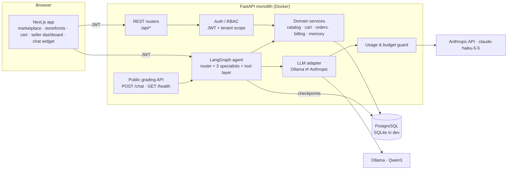
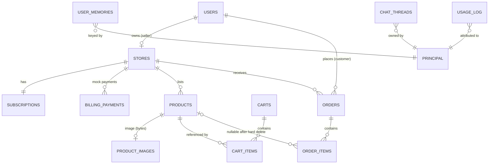
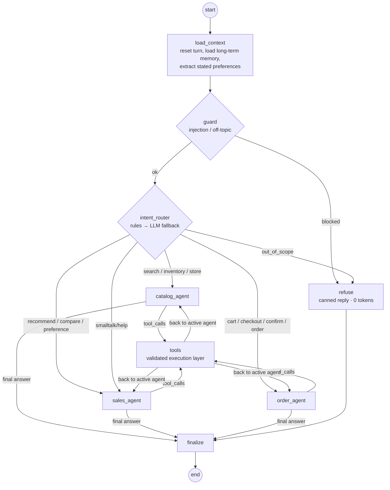

# OneSeller AI — Architecture

> **One Agent for every Seller.** A multi-tenant marketplace where every seller gets an AI sales representative.

This document is the design of record. It was written before implementation and is kept in sync with the code.

---

## 1. System overview

The simplest architecture that meets the requirements: **one Next.js frontend, one FastAPI monolith, one relational database.** No microservices, no message queues.



| Layer | Technology | Notes |
|---|---|---|
| Frontend | Next.js (App Router), TypeScript, Tailwind CSS | Hand-rolled small component set (no heavy UI lib). Deployed on Vercel. |
| Backend | FastAPI, Pydantic v2, SQLAlchemy 2.0, Alembic | Sync SQLAlchemy in FastAPI's threadpool — simple and adequate for MVP load. |
| Agent | LangGraph `StateGraph` + LangChain chat-model integrations | Checkpointer = `SqliteSaver` (dev) / `PostgresSaver` (prod). |
| LLM | `langchain-ollama` (Qwen3) or `langchain-anthropic` (`claude-haiku-5-5`) | Selected by `LLM_PROVIDER` env var; business logic is provider-agnostic. |
| DB | PostgreSQL (Neon/Supabase) in prod, SQLite file in dev | Same SQLAlchemy models; portable SQL only (no PG-only features). |

### Backend module layout

```
backend/app/
  main.py              app factory, middleware, router mounting
  config.py            Settings (pydantic-settings, env-driven)
  db.py                engine / session factory
  models.py            SQLAlchemy ORM models
  schemas.py           Pydantic request/response models
  security.py          password hashing, JWT, current-user deps, role guards
  ratelimit.py         in-process token-bucket limiter
  services/
    catalog.py         product search/filter, normalization, product CRUD, CSV/XLSX import
    cart.py            cart ops keyed by principal
    orders.py          transactional checkout, order status
    billing.py         plans, trial, mock payments, entitlement checks
    memory.py          long-term preference store
    usage.py           token/cost ledger + budget guard
  agent/
    state.py           AgentState TypedDict
    llm.py             provider adapter
    guard.py           injection / off-topic detection, affirmation parsing
    tools.py           tool schemas + implementations (DB-backed)
    prompts.py         per-node system prompts
    graph.py           StateGraph wiring + checkpointer
    runner.py          run_turn(): thread ownership, invocation, response shaping
  routers/
    public.py          /chat, /health
    auth.py            /api/auth/*
    marketplace.py     /api/products, /api/stores, /api/categories, images
    customer.py        /api/me, /api/cart, /api/checkout, /api/orders, /api/me/memory
    seller.py          /api/seller/*
    chat.py            /api/chat (authenticated agent chat), /api/chat/threads
```

---

## 2. Data model



**Principal.** Every cart, memory, chat thread and agent order is keyed by a *principal* string:

| Principal | Source | Trust |
|---|---|---|
| `user:<id>` | JWT of an authenticated customer | Verified — real cart, real orders, saved delivery details |
| `api:<user_id>` | `user_id` field of the public `/chat` API | **Unverified** — sandboxed namespace, no access to any `user:*` data |

The two namespaces never overlap, so a caller of the public API can never reach a real customer's data by guessing an ID.

### Tables

| Table | Key columns | Notes |
|---|---|---|
| `users` | id, email (unique), password_hash, role (`customer`/`seller`), full_name, phone, address, city, postal_code | Delivery details live on the user (minimal PII). |
| `stores` | id, owner_id (unique FK users), name, slug (unique), description, tagline, brand_color, is_active | One store per seller. URL `/store/{slug}`. |
| `subscriptions` | store_id (unique), plan (`trial`/`standard`/`premium`), status, period_start, period_end | Status is *computed* from `period_end` on read, so expiry needs no cron. |
| `billing_payments` | store_id, plan, amount, currency, reference, created_at | Mock payment ledger. |
| `products` | id, store_id, sku, name, description, category, price `Numeric(12,2)`, colors, sizes, stock, image_id, is_active, deleted_at | `colors`/`sizes` stored as normalized `,a,b,` text for portable `LIKE` filtering. Soft delete = `is_active=false, deleted_at=now`. |
| `product_images` | id, store_id, content_type, data (bytes) | In DB so images survive container redeploys (HF Spaces disk is ephemeral). 2 MB cap. |
| `carts` / `cart_items` | cart.principal (unique); item: product_id, quantity, color, size | Unique `(cart_id, product_id, color, size)`. |
| `orders` | id, principal, customer_id (nullable), store_id, status, total, delivery snapshot, payment_status, channel (`web`/`agent`/`public_api`), is_sandbox, idempotency_key (unique), checkout_group | One order per store per checkout (cross-seller carts split). |
| `order_items` | order_id, product_id (nullable, `ON DELETE SET NULL`), product_name, unit_price, quantity, color, size | **Snapshots** name & price so history survives edits and hard deletes. |
| `user_memories` | principal, key, value, updated_at | Unique `(principal, key)`. Keys: `preferred_categories`, `preferred_colors`, `preferred_sizes`, `budget_max`, `notes`. |
| `chat_threads` | principal, thread_id, checkpoint_key, title | Unique `(principal, thread_id)`; registry of a user's conversations. |
| `usage_log` | provider, model, tokens_in, tokens_out, cost_usd, principal, created_at | Feeds the spending guard and the benchmark report. |

---

## 3. Authentication & authorization

- **Passwords:** bcrypt. **Sessions:** stateless HS256 JWT (`sub`, `role`, `exp`), sent as `Authorization: Bearer`.
- **Role guards:** `require_customer`, `require_seller` FastAPI dependencies.
- **Tenant scope:** every seller query is filtered by `store_id == current_seller.store.id` inside the service layer — never by an ID from the request body. Fetching another tenant's product/order returns **404** (not 403) to avoid ID probing.
- **Customer scope:** carts and orders are filtered by principal `user:<jwt sub>`.
- The agent's tools receive the principal from **graph config set by the server**, never from LLM-generated arguments; tool argument schemas do not even contain a `user_id` field.

---

## 4. Seller lifecycle & subscriptions

| Plan | Price (PKR/month, configurable) | Monthly order limit (configurable) | Marketplace placement |
|---|---|---|---|
| Free trial | 0 — 1 calendar month from signup | 50 | normal |
| Standard | 2,500 | 300 | normal |
| Premium | 6,000 | 2,000 | "Premium" badge + featured section |

- Registration atomically creates **user → store (unique slug) → trial subscription** (`period_end = signup + 1 calendar month`, using `dateutil.relativedelta`).
- **Entitlement check (backend):** `billing.assert_store_active(store)` guards product creation/import/updates, and `billing.assert_can_accept_order(store)` guards checkout (active + under monthly order limit). Expired stores are hidden from the marketplace and agent search.
- **Mock billing:** `POST /api/seller/billing/pay {plan}` records a payment and sets/renews the period (renewal extends from the current `period_end` if still active, otherwise from now). Upgrade = pay for the higher plan. `POST /api/seller/billing/simulate-expiry` (enabled by `ALLOW_BILLING_SIMULATION`) backdates `period_end` for demos/tests.

---

## 5. Cart & order lifecycle

```
cart (principal) ──checkout──▶ validate (stock, active product, store entitlement)
                               │  SELECT … FOR UPDATE on products (PostgreSQL)
                               ▼
                   one Order per store  (status = confirmed, payment = mock_paid)
                   stock -= qty  (same transaction)  → cart cleared → commit
Seller updates:  confirmed → processing → shipped → delivered   (or cancelled → stock restored)
```

- **Atomicity:** the whole checkout is one DB transaction; stock is re-checked inside it with a conditional `UPDATE products SET stock = stock - :q WHERE id=:id AND stock >= :q`. If any row fails, the transaction rolls back → no overselling.
- **Idempotency:** each checkout carries an idempotency key (`Idempotency-Key` header on the web; the confirmation token for the agent). `orders.idempotency_key` is unique; a replay returns the original orders.
- **Public API orders** (`api:*` principals) are validated identically but stored with `is_sandbox=true` and do **not** decrement real inventory (`PUBLIC_API_ORDERS_AFFECT_INVENTORY=false`), so anonymous callers can't drain sellers' stock.

---

## 6. Agent design (LangGraph)

### 6.1 Graph



Conditional edges ensure only the needed nodes run. Each specialist has **its own system prompt and its own tool subset**; the shared `tools` node re-checks that the requested tool belongs to the active agent before executing it.

| Node | LLM? | Distinct responsibility | Tools allowed |
|---|---|---|---|
| `load_context` | no | Reset per-turn counters, load `user_memories`, run deterministic preference extraction on the new message and persist it, trim history. | — |
| `guard` | no | Regex/heuristic prompt-injection and off-topic screen; blocks before any LLM call. | — |
| `intent_router` | rarely | Deterministic keyword/state rules (pending confirmation + "yes" ⇒ `confirm`); falls back to a 1-word LLM classification only for ambiguous messages. | — |
| `catalog_agent` | yes | Factual lookup: filters, prices, stock, variants, stores. | `search_products`, `get_product_details`, `check_inventory`, `search_stores` |
| `sales_agent` | yes | Needs analysis, recommendation, comparison, preference follow-up. | `search_products`, `get_product_details`, `compare_products`, `save_preference` |
| `order_agent` | yes* | Cart edits, delivery details, checkout preparation, confirmed order creation. *On a confirmed "yes" it emits the `create_order` call deterministically (no LLM). | `add_to_cart`, `remove_from_cart`, `get_cart`, `set_delivery_details`, `prepare_checkout`, `create_order` |
| `tools` | no | Validates args (Pydantic), injects principal, executes, records `tool_calls`, updates state (`last_products`, `pending_order`). | — |
| `refuse` | no | Fixed safe reply for blocked / off-topic input. | — |
| `finalize` | no | Produces reply; templated order confirmation built **only** from the DB result. | — |

### 6.2 State

```python
class AgentState(TypedDict):
    messages: Annotated[list[AnyMessage], add_messages]   # short-term memory (checkpointed)
    principal: str
    intent: str
    active_agent: str
    last_products: list[dict]      # compact rows from the last search/compare (id, name, price, stock, store…)
    pending_order: dict | None     # {token, cart_hash, total, lines, delivery} awaiting "yes"
    delivery: dict                 # collected name/phone/address/city
    profile: dict                  # long-term preferences (loaded each turn)
    blocked_reason: str | None
    steps: int                     # tool-loop guard (max 4 per turn)
    turn_tool_calls: list[dict]    # reported in /chat response
    turn_tokens: dict              # {"in": int, "out": int}
```

### 6.3 Tools

All tools are DB-backed, return JSON with `ok: bool`, and never accept identity arguments.

| Tool | Args | Returns |
|---|---|---|
| `search_products` | query?, category?, color?, size?, min_price?, max_price?, store?, in_stock_only?, limit≤10 | product rows (id, name, price, colors, sizes, stock, store) |
| `get_product_details` | product_id | full product incl. description, variants |
| `check_inventory` | product_id, color?, size?, quantity? | stock, `available`, whether variant exists |
| `search_stores` | query | stores (name, slug, description, product count, premium flag) |
| `compare_products` | product_ids (2–5) | side-by-side rows + cheapest / most-stock ids |
| `save_preference` | key ∈ {category, color, size, budget_max, note}, value | stored memory |
| `add_to_cart` | product_id, quantity, color?, size? | updated cart; validates stock, variant, active store |
| `remove_from_cart` | product_id | updated cart |
| `get_cart` | — | lines, totals |
| `set_delivery_details` | name?, phone?, address?, city? | collected details + missing fields |
| `prepare_checkout` | — | `needs_details` **or** `awaiting_confirmation` with summary + token (stored in state) |
| `create_order` | confirmation_token | created orders (ids, totals) — **rejected** unless token matches `pending_order`, cart unchanged, and the *current user message* is an explicit affirmation |

Human-in-the-loop is enforced **in code** at the `create_order` gate, not by the prompt.

### 6.4 Grounding rules
- Product facts in replies come only from tool results; the system prompt forbids invention and the finalize step never fabricates order confirmations.
- Tool output and product descriptions are wrapped as data (`<tool_data>…</tool_data>`) and the prompts state that text inside is untrusted and never instructions.
- Premium placement is used only in marketplace UI ordering; agent search ranks by relevance then price.

---

## 7. Memory

| | Short-term | Long-term |
|---|---|---|
| Scope | One conversation (`thread_id`) | One user (`user_id` / principal) across all threads |
| Content | Messages, tool results, `last_products`, pending confirmation, delivery details collected | Preferred categories, colors, sizes, budget, explicit notes |
| Store | LangGraph checkpointer tables in the same DB (`SqliteSaver` / `PostgresSaver`) | `user_memories` table |
| Survives restart | Yes (DB-backed checkpoints) | Yes |
| Written by | Graph each step | Deterministic extractor in `load_context` + `save_preference` tool |
| Read by | Graph on resume | Injected into specialist prompts as a compact profile |
| Token control | Only the last N user/assistant exchanges + current-turn tool messages are sent to the LLM; history beyond `MAX_HISTORY_MESSAGES` is pruned | Tiny key/value profile |
| User control | — | `GET/DELETE /api/me/memory` |

**Thread isolation:** the checkpoint key is `sha256(principal + ":" + thread_id)`. A different `user_id` sending the same `thread_id` lands on a *different* checkpoint — threads cannot be hijacked or reassigned.

---

## 8. Security controls

| Threat | Control |
|---|---|
| Prompt injection / instruction override | `guard` node blocks known patterns pre-LLM; prompts isolate untrusted data; tools cannot do anything a principal isn't authorized to do anyway. |
| Off-topic use | Router `out_of_scope` + canned refusal (also saves tokens). |
| Cross-tenant access | Service-layer scoping by JWT-derived store/principal; 404 on foreign IDs; tested at API level. |
| Unauthorized orders | `create_order` gate (token + cart hash + affirmation); idempotency key. |
| Public API abuse | Separate `api:*` namespace, sandbox orders, rate limit per IP + user_id, max message length. |
| Destructive deletes | Soft delete default; hard delete requires `?confirm=true` and is refused for products in open orders. |
| Overspend | Budget guard checks `usage_log` total + reserve before each paid LLM call; hard cap `LLM_BUDGET_USD`. |
| Failures | LLM calls retried (provider SDK retries) with timeout; turn wall-clock timeout; DB errors → 503 with friendly message; all errors logged with request id. |

---

## 9. API summary

| Method & path | Auth | Purpose |
|---|---|---|
| `POST /chat` | public | Grading API → `{reply, tool_calls, tokens:{in,out}}` |
| `GET /health` | public | `ok` (text/plain) |
| `POST /api/auth/register` | public | `{email, password, full_name, role, store_name?}` → token |
| `POST /api/auth/login`, `GET /api/auth/me` | public / user | |
| `GET /api/products` | public | search: `q, category, color, size, min_price, max_price, store, in_stock, sort, page` |
| `GET /api/products/{id}`, `GET /api/stores`, `GET /api/stores/{slug}`, `GET /api/categories`, `GET /api/home`, `GET /api/images/{id}` | public | |
| `GET/PUT /api/me` | customer | profile & delivery details |
| `GET /api/cart`, `POST /api/cart/items`, `PATCH/DELETE /api/cart/items/{id}` | customer | |
| `POST /api/checkout` | customer | `Idempotency-Key` header; explicit `confirm: true` |
| `GET /api/orders`, `GET /api/orders/{id}` | customer | own orders |
| `GET/DELETE /api/me/memory` | customer | long-term memory control |
| `POST /api/chat`, `GET /api/chat/threads`, `GET /api/chat/threads/{id}` | customer | authenticated agent chat |
| `GET /api/seller/dashboard` | seller | KPIs |
| `GET/PUT /api/seller/store` | seller | customise storefront |
| `GET/POST /api/seller/products`, `PUT /api/seller/products/{id}`, `POST …/{id}/restore`, `DELETE …/{id}?hard=&confirm=` | seller | |
| `POST /api/seller/products/bulk` | seller | bulk soft-delete / restore / stock / price |
| `POST /api/seller/products/import` | seller | CSV / XLSX import with per-row error report |
| `POST /api/seller/images` | seller | image upload |
| `GET /api/seller/orders`, `PATCH /api/seller/orders/{id}` | seller | |
| `GET /api/seller/billing`, `POST /api/seller/billing/pay`, `POST /api/seller/billing/simulate-expiry` | seller | mock billing |

---

## 10. Error handling & logging
- Domain errors raise `AppError(status, code, message)` → JSON `{"error": {"code","message"}}`.
- Validation errors → 422 with field details; unexpected errors → 500 with a request id (logged with stack trace, never shown to user).
- `/chat` never returns a non-schema body for agent failures: it returns 200 with a polite `reply`, empty `tool_calls`, and the tokens actually spent. Malformed requests still get 422.
- Structured logging (`logging` with request id, path, latency).

## 11. Testing strategy
- **Unit/API (pytest):** auth, tenant isolation (seller A vs B, customer A vs B), subscription enforcement, soft/hard delete integrity, CSV/XLSX import, transactional checkout & oversell prevention, idempotency.
- **Agent graph tests (pytest, scripted fake LLM):** routing, tool-scope enforcement, confirmation gate, thread isolation, persistence across graph rebuilds (simulated restart). Deterministic, no network.
- **Benchmark runner (`benchmarks/run.py`):** drives `/chat` (or in-process app) with `tests.json` (10 functional cases, multi-turn, with restart steps) and `security_tests.json` (5 attacks); reports success rate, tool-call accuracy, tokens, cost, latency. Runs against Ollama (Phase 2) or Claude (Phase 3, budget-guarded).

## 12. Deployment
- **Frontend:** Vercel (Hobby). `NEXT_PUBLIC_API_URL` → backend.
- **Backend:** Docker image on Hugging Face Spaces (Docker SDK, port 7860) — or Render free web service.
- **DB:** Neon/Supabase Postgres; Alembic migrations run on container start; LangGraph `PostgresSaver.setup()` creates checkpoint tables.
- Secrets only via platform env vars; `.env` is git-ignored; `.env.example` documents every variable.
