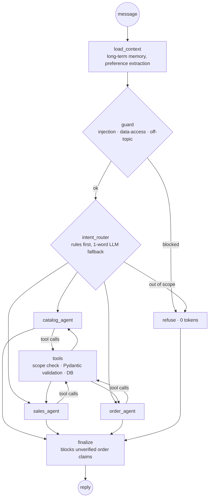

# OneSeller AI

**One Agent for every Seller.** A multi-tenant marketplace where every small online seller gets an AI sales representative that searches the real catalog, compares products, remembers shopper preferences, manages the cart, and places orders **only after the customer explicitly confirms**.

| | |
|---|---|
| Frontend | Next.js 15 · TypeScript · Tailwind CSS |
| Backend | Python FastAPI · Pydantic · SQLAlchemy 2 · Alembic |
| Agent | LangGraph (router + 3 specialist agents + validated tool layer) |
| LLM | Local Qwen3‑4B‑Instruct via Ollama (dev) · `claude-haiku-5-5` (final), switchable by env var |
| Database | PostgreSQL (Neon / Supabase) in production · SQLite locally |

> **Status:** Phase 1 (architecture + baseline implementation) complete and verified locally. Benchmarks (Phase 2), Claude evaluation (Phase 3) and deployment (Phase 4) are pending — see [Project status](#project-status).

Full design: **[ARCHITECTURE.md](ARCHITECTURE.md)** (system diagram, ER diagram, agent graph, tools, memory, security, API).

---

## Features

**Customers** — marketplace landing page (premium & top-seller sections, categories, new arrivals), search by name / category / color / size / price range / store / availability, storefront pages at `/store/{slug}`, product pages with variants, cart, checkout with review + explicit confirmation + mock payment, order history, profile & delivery details, view/delete what the AI remembers, AI chat widget on every page.

**Sellers** — registration creates the store, a unique storefront URL and a **one-month free trial**; dashboard KPIs from real data (sales, total/pending/completed orders, active & low-stock products, recent orders, trial days left); add/edit products with image upload, colors, sizes, categories; **CSV/XLSX import** with per-row error report and SKU upsert; multi-select bulk operations; **soft delete (default, recoverable)** and **hard delete** (typed confirmation; refused while the product is in open orders; past orders keep name/price snapshots); order fulfilment workflow; storefront branding; mock billing (Standard / Premium plans, upgrade, renewal, expiry) enforced in the backend.

**AI agent** — see below.

---

## Agent workflow



| Node | What it does differently |
|---|---|
| `catalog_agent` | Factual lookup: `search_products`, `get_product_details`, `check_inventory`, `search_stores` |
| `sales_agent` | Recommends / compares / follows up on preferences: `search_products`, `get_product_details`, `compare_products`, `save_preference` |
| `order_agent` | Cart & checkout: `add_to_cart`, `remove_from_cart`, `get_cart`, `set_delivery_details`, `prepare_checkout`, `create_order`, `get_my_orders`. The checkout summary and order confirmation are **deterministic** (no LLM, 0 tokens). |

### Tools
All tools are database-backed and return structured JSON (`ok`, data or error). Identity is **never** a tool argument — the server injects the principal from graph config.

| Tool | Purpose |
|---|---|
| `search_products` | Filtered catalog search (keywords, category, color, size, price range, store, in-stock). Also parses filters left in free text ("under Rs. 3000", "medium"). |
| `get_product_details` / `check_inventory` | Live price, stock, variants for one product (variant + quantity availability). |
| `search_stores` | Find active stores. |
| `compare_products` | Side-by-side comparison with cheapest / most-stock ids. |
| `save_preference` | Persist an explicitly stated preference (category, color, size, budget, note). |
| `add_to_cart` / `remove_from_cart` / `get_cart` | Validated against stock, variants and store status. |
| `set_delivery_details` | Collect name / phone / address / city. |
| `prepare_checkout` | Validates cart + details and issues a one-time confirmation token. Does **not** place an order. |
| `create_order` | **Gate in code:** requires the pending token, an unchanged cart, *and* an explicit affirmative user message ("yes", "confirm", …). Transactional, idempotent. |
| `get_my_orders` | The caller's own orders only. |

---

## Memory

| | **Short-term memory** | **Long-term memory** |
|---|---|---|
| Scope | One conversation (`thread_id`) | One user (`user_id`) across all conversations |
| Holds | Messages, tool results, products just shown (for "which one is cheaper?"), delivery details, pending checkout confirmation | Preferred categories / colors / sizes, typical budget, explicit notes |
| Stored in | LangGraph checkpointer tables in the database (`SqliteSaver` locally, `PostgresSaver` in production) | `user_memories` table |
| Survives restarts | Yes (verified by tests that rebuild the graph mid-conversation) | Yes |
| Written by | The graph, every step | Deterministic extractor for explicit statements ("I usually wear size M") + `save_preference` tool |
| Token control | Only recent user/assistant turns + the current turn's tool messages are sent to the LLM; old checkpoint messages are pruned | Compact key/value profile injected into prompts |
| User control | Start a new chat | Account page → view / remove individual items or forget everything (`GET/DELETE /api/me/memory`) |

## User isolation

- **Principals.** Carts, memory, threads and agent orders are keyed by a principal: `user:<id>` from a verified JWT, or `api:<user_id>` for the unauthenticated public `/chat` API. The namespaces never overlap, so the public API can't reach any real account by guessing an ID.
- **Sellers.** Every seller endpoint derives `store_id` from the JWT inside the service layer; another tenant's product/order returns **404** (no ID probing). Tested for read, update, delete, restore, bulk, orders, images and dashboard KPIs.
- **Customers.** Carts and orders are filtered by the JWT principal; other customers' orders return 404.
- **Threads.** The checkpoint key is `sha256(principal:thread_id)`, so the same `thread_id` from a different user opens a *different* conversation — a thread can't be read or reassigned by submitting another `user_id`.
- **Public API.** `/chat` can browse the public catalog and run a sandbox cart/checkout in its own namespace (sandbox orders don't reserve real stock). It has no access to seller dashboards, real customer data or privileged operations.

## Safety & reliability

Pre-LLM guard (prompt injection, cross-user data requests, off-topic) · untrusted tool data wrapped in `<tool_data>` and declared non-instructional · per-agent tool allow-lists · Pydantic argument validation · confirmation gate for orders and typed confirmation for permanent deletes · output check that replaces any "order confirmed" claim not backed by a successful `create_order` · transactional checkout with conditional stock updates (no overselling) · idempotency keys · rate limiting (per IP and per user) · LLM retries and a turn timeout · the `/chat` contract is preserved even when the LLM or DB fails · **hard spending cap** for paid LLM calls checked against a usage ledger before every call.

---

## Grading API (public, no auth)

```bash
curl -X POST $API/chat -H 'Content-Type: application/json' \
  -d '{"user_id":"user_123","thread_id":"thread_456","message":"Show me black shirts under Rs. 3000"}'
# → {"reply": "...", "tool_calls": [{"name":"search_products","args":{...},"agent":"catalog_agent","ok":true}], "tokens": {"in": 2431, "out": 274}}

curl $API/health   # → ok
```

Interactive docs for the full API: `$API/docs`.

---

## Local setup

Prerequisites: Python 3.12 + [uv](https://docs.astral.sh/uv/), Node 20+, [Ollama](https://ollama.com).

```bash
cp .env.example .env                       # adjust if needed; never commit .env
ollama pull qwen3:4b-instruct-2507-q4_K_M  # local model (fits a 4 GB GPU)

# backend
cd backend
uv sync
uv run alembic upgrade head
uv run python -m app.seed                  # demo stores, products and accounts (password: demo12345)
uv run uvicorn app.main:app --port 8000

# frontend (new terminal)
cd frontend
npm install
echo "NEXT_PUBLIC_API_URL=http://localhost:8000" > .env.local
npm run dev                                # http://localhost:3000
```

Demo accounts (password `demo12345`): customer `customer@demo.oneseller.ai`; sellers `urbanthreads@demo.oneseller.ai` (Premium), `rangrez@…`, `stridesneakers@…`, `lumiere@demo.oneseller.ai`.

Switch to Claude: set `LLM_PROVIDER=anthropic`, `ANTHROPIC_API_KEY=…` (model `claude-haiku-5-5`, spending capped by `LLM_BUDGET_USD`).

### Tests

```bash
cd backend
uv run pytest -q                              # 33 tests, no network (scripted fake LLM)
PYTHONPATH=. uv run python scripts/smoke_demo.py     # spec demo conversation against the configured LLM
uv run python scripts/http_e2e.py http://localhost:8000  # full seller→customer→agent order flow over HTTP
```

### Environment variables
See [`.env.example`](.env.example) for every variable (database, JWT secret, CORS, LLM provider/model, budget cap, plan prices and order limits, billing simulation, frontend API URL).

---

## Project status

| Phase | Status |
|---|---|
| 1 · Architecture, repository, baseline | ✅ Done — see [benchmarks/BASELINE.md](benchmarks/BASELINE.md) |
| 2 · Local Qwen benchmark suite (`tests.json`, security suite) & iterative fixes | ⏳ Next |
| 3 · Final `claude-haiku-5-5` evaluation (≤ $1, budget-guarded) | ⏳ Pending |
| 4 · Deployment (Vercel + HF Spaces/Render + Neon/Supabase), demo GIF/video | ⏳ Pending |

The benchmark table, deployment URLs and demo GIF will be added here as those phases complete.
